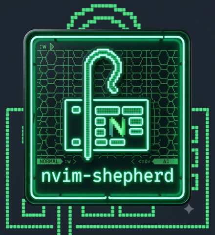

<table>
<tr>
<td width="200" valign="top"></td>
<td valign="top">

# 𓋾 nvim-shepherd

Neovim wrapper for [shepherd](https://github.com/jwarykowski/shepherd) — opens
the todo board in a floating terminal and adds items without leaving your
buffer. Zero dependencies; drives the installed `shepherd` binary.

</td>
</tr>
</table>

- [requirements](#requirements)
- [install](#install)
- [usage](#usage)
- [stats](#stats)
- [statusline](#statusline)
- [configuration](#configuration)
- [development](#development)
- [support](#support)


## requirements

- Neovim ≥ 0.11 (`vim.fn.jobstart({ term = true })`, `vim.system`).
- `shepherd` on `$PATH` — `brew install jwarykowski/tap/shepherd`.

## install

lazy.nvim — add the spec. With a structured config (e.g. LazyVim), drop it in
its own file at `lua/plugins/shepherd.lua`; otherwise add it to your existing
plugin list:

```lua
return {
	"jwarykowski/nvim-shepherd",
	cmd = {
		"Shepherd",
		"ShepherdAdd",
		"ShepherdList",
		"ShepherdCapture",
		"ShepherdStats",
		"ShepherdBoards",
		"ShepherdBoardsArchived",
	},
	keys = {
		{ "<leader>T", "<cmd>Shepherd<cr>", desc = "shepherd board" },
		{ "<leader>tg", "<cmd>Shepherd!<cr>", desc = "shepherd global view (all boards)" },
		{ "<leader>ta", "<cmd>ShepherdAdd<cr>", desc = "shepherd quick-add" },
		{ "<leader>tl", "<cmd>ShepherdList<cr>", desc = "shepherd list / pick" },
		{ "<leader>tc", "<cmd>ShepherdCapture<cr>", desc = "shepherd capture line" },
		{ "<leader>tc", ":ShepherdCapture<cr>", mode = "x", desc = "shepherd capture selection" },
		{ "<leader>ts", "<cmd>ShepherdStats<cr>", desc = "shepherd stats" },
		{ "<leader>tb", "<cmd>ShepherdBoards<cr>", desc = "shepherd boards" },
	},
	opts = {
		-- per-repo board (own file under ~/.config/shepherd/boards/)
		board = function()
			return vim.fn.fnamemodify(vim.fn.getcwd(), ":t")
		end,
	},
}
```

`opts` (even `{}`) triggers `setup()`, which registers the commands. `cmd` and
`keys` lazy-load the plugin — it loads on first `:Shepherd`, `<leader>T`, or
`<leader>ta`.

## usage

- `:Shepherd` — open the board in a floating terminal. Closes when shepherd
  exits (`q`).
- `:Shepherd work` — open with an explicit filter, overriding the configured
  one for that view.
- `:Shepherd!` — open the read-only global view across all boards
  (`shepherd --all`).
- `:ShepherdAdd` — prompt for a todo, then `shepherd add` it. An open board
  reloads and shows it within ~2s.
- `:ShepherdAdd deploy api @work !h due:tomorrow` — add directly, with the same
  quick-add tokens the board accepts.
- `:ShepherdList` — pick an item (`vim.ui.select`), then act on it: toggle
  done/undone, **edit** (a pre-filled quick-add line — text, `@category`,
  `!priority`, `due:`, `defer:`, `link:`, `note:`), set a **status**, add a
  **subtask**, **archive** it (whole items only), **rm**, or **open link** when
  it has one. Subtasks show indented
  under their parent and take the same actions. Uses whatever `vim.ui.select` UI
  you have (dressing, snacks, telescope-ui-select), or the built-in menu.
- `:ShepherdList work` — pick within a filtered view. `:ShepherdList!` picks
  across all boards (read-only — items show their `[board]`; only open-link is
  offered).
- `:ShepherdStats` — open shepherd's stats charts in the floating terminal (see
  [stats](#stats)). `:ShepherdStats!` aggregates every board.
- `:ShepherdBoards` — pick a board (shows `open/total`, `*` marks current, and
  its working **dir** if set), then **switch** the session to it, **rename**,
  set its **dir** (working directory; empty clears), **archive**, or **delete**
  it (delete shows a dry-run preview and asks to confirm first). Switching
  overrides the configured `board` until you switch again or restart, and
  `:tcd`s to the board's dir when it has one.
- `:ShepherdBoardsArchived` — pick an archived board to unarchive.
- `:ShepherdCapture` — turn the current line into a todo; in visual mode
  (`:'<,'>ShepherdCapture`) the selection. Strips a leading comment marker and
  `TODO:`/`FIXME:`, then opens the add prompt pre-filled so you can tweak it.

Run `:checkhealth shepherd` to verify the binary is found.

## stats

`:ShepherdStats` runs `shepherd stats` in the floating terminal — completion, due
and urgency, priority load, aging, status mix, throughput and backlog trend for
the active board. `:ShepherdStats!` aggregates every board and adds a by-board
breakdown.


The charts are one-shot output, so the float holds until you dismiss it with `q`,
`<esc>` or `<cr>` — unlike `:Shepherd`, which closes when the board exits.
Done-based counts include the archive.

## statusline

`require("shepherd").status()` returns a short string — the open count, plus an
overdue suffix — or `""` when there's nothing open or the count hasn't loaded
yet. Counts refresh live on every board change — yours, the board TUI's, or
another process's — plus on `FocusGained`; call
`require("shepherd").refresh()` to force it. Set `watch = false` (see
[configuration](#configuration)) to drop back to `FocusGained` only.

lualine:

```lua
require("lualine").setup({
	sections = {
		lualine_x = { { function() return require("shepherd").status() end } },
	},
})
```

Native statusline:

```lua
vim.o.statusline = "%{v:lua.require'shepherd'.status()}"
```

The count covers the configured board (all todos on it, independent
of `config.filter`); with no `board` set, the default board. A refresh
fires the `User ShepherdStatusUpdate` autocmd — hook it if your statusline
needs a manual redraw:

```lua
vim.api.nvim_create_autocmd("User", {
	pattern = "ShepherdStatusUpdate",
	callback = function() vim.cmd.redrawstatus() end,
})
```

## configuration

Defaults:

```lua
require("shepherd").setup({
	cmd = "shepherd",        -- binary name / path
	filter = nil,            -- string | fun():string | nil — passed as --filter
	board = nil,             -- string | fun():string | nil — passed as --board
	float = { width = 0.8, height = 0.8, border = "rounded" },
	status = { icon = "" },  -- prefix for status(); e.g. a nerd-font glyph
	watch = true,            -- stream `shepherd watch` to keep the statusline live
})
```

- `filter` — a string, or a function returning one (evaluated on each open, so
  it can track the current project). `nil`/empty means no filter.
- `board` — a shepherd board name (string or function, e.g. derive it
  from the cwd). Scopes everything — board, add, list/pick, statusline counts —
  to `~/.config/shepherd/boards/<name>.md`. `nil`/empty uses the default
  board. `:Shepherd!` ignores it and shows all boards. `:ShepherdBoards` →
  *switch* overrides it for the session.
- `float` — fractions of the editor size, and the window border.
- `status.icon` — prefix for `status()`. With an icon it renders `<icon> 3`;
  empty renders `3 todo`.
- `watch` — streams `shepherd watch` in the background and refreshes the
  statusline counts on every board change (from the TUI or another process), not
  just on `FocusGained`. Re-scopes to the active board on switch, and stops on
  exit. One extra process per Neovim, polling the board file once a second; set
  it to `false` to skip that. Needs shepherd ≥ 0.16 (the `watch` verb); with no
  `shepherd` on `$PATH` it simply doesn't start.

## development

```sh
make fmt     # stylua
make lint    # stylua --check + luacheck
make test    # busted
make check   # lint + test
```

See [CONTRIBUTING.md](CONTRIBUTING.md) for the layout, the test approach, the
conventions, and how to re-record the demo gif.

## support

nvim-shepherd is free and MIT licensed. If it keeps your todos close to your
code, you can [sponsor its
development](https://github.com/sponsors/jwarykowski).
